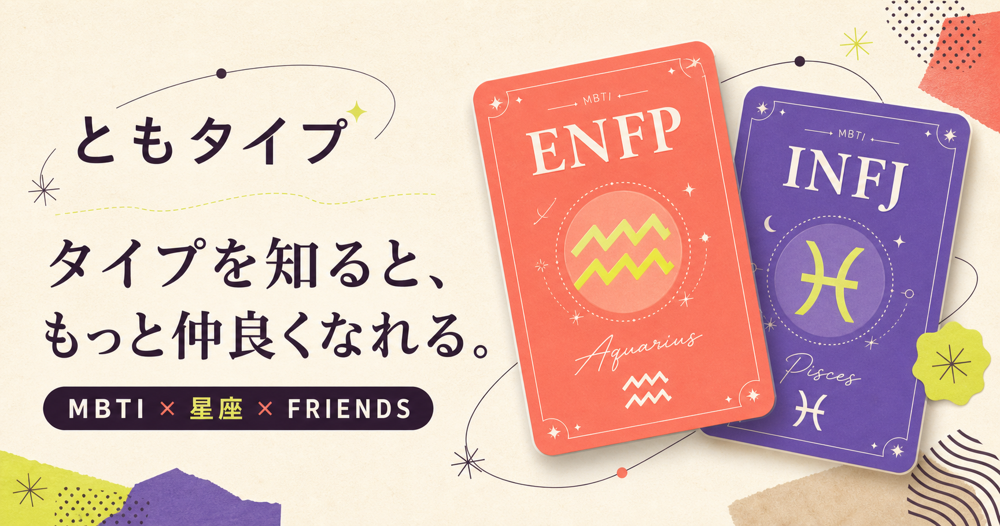

# ともタイプ

友達の性格タイプや好み、会話のメモを整理し、次に会うときの話題や過ごし方を考えるためのアプリです。アカウント登録を不要とし、プロフィールのQR交換から友達情報の管理まで、端末内で完結する構成にしています。



## 主な機能

- **プロフィール交換**：性格タイプ、生年月日、好みをQRコード・共有リンクで交換
- **友達ノート**：友達ごとの情報、コミュニティ、好み、メモを管理
- **会う直前モード**：次に話したいことや好みを一画面で確認
- **交流のヒント**：目的別の相性ランキング、友達同士の紹介提案を表示
- **バックアップ**：端末内データをJSONで保存・復元
- **iOS連携**：QRカメラ、誕生日のローカル通知、OSの共有機能に対応

## 使用技術

| 分野 | 技術 |
| --- | --- |
| 画面・ロジック | React、TypeScript、CSS |
| Web・ビルド | Vite、Vinext |
| iOS連携 | Capacitor、Swift |
| データ保存 | SQLite（iOS）、localStorage（ブラウザー） |
| QRコード | qrcode |
| 品質管理 | ESLint、Node.js Test Runner、GitHub Actions、Semgrep、Gitleaks |

## 設計・実装の工夫

- **端末内での保存・計算**：友達情報を運営サーバーへ送らず、相性や紹介提案も端末内で計算します。保存処理を画面から分離し、ブラウザーとiOSで保存先を切り替えています。
- **共有範囲の限定**：QRには本人のプロフィールだけを含め、友達一覧やメモを含めません。共有データはURLのフラグメントに格納し、通常のページ取得リクエストへ載せない構成です。
- **データの検証と互換性**：不正な日付や入力値を検証し、旧形式のプロフィール・QR・バックアップにも対応しています。保存データを読み込めない場合は、空データで上書きしないようにしています。
- **用途に合わせた画面設計**：友達情報を一覧・詳細・会う直前の用途に分け、iOSにはSwiftで生年月日選択画面を実装しています。

主要な実装は、[画面](app/page.tsx)、[相性計算・データ検証](lib/tomotype-model.ts)、[端末内保存](lib/device-storage.ts)、[iOS連携](lib/mobile-platform.ts)、[Swiftによる日付選択](ios/App/App/SceneDelegate.swift) から確認できます。

## 検証・実装状況

2026年10月1日時点で、Web・モバイルのビルド、型チェック、Lint、自動テスト49件が合格しています。テストでは日付の境界値、相性計算、データ復元、共有範囲などを確認しています。公開対象ファイルのGitleaks検査と、実行時依存ライブラリの既知の脆弱性検査でも検出はありませんでした。

GitHub Actionsには品質チェック、Semgrep、Gitleaksを設定しています。検証の詳細は [ローカル検証結果](docs/VALIDATION.md) にまとめています。

主要機能は実装済みです。App Store配布、プレミアム決済、iOS実機での動作確認は未完了です。相性表示は、友達との会話や交流のきっかけとなるアプリ内の目安です。

## 動作確認

Node.js 24以上で実行できます。

```sh
npm ci
npm run mobile:dev
```

ブラウザーで友達情報の保存・編集や相性表示を確認できます。架空のデータは、アプリの「データとプライバシー」→「バックアップを復元」から [デモデータ](docs/demo-backup.json) を読み込んで試せます。QRカメラと誕生日通知はiOS向けの機能です。
